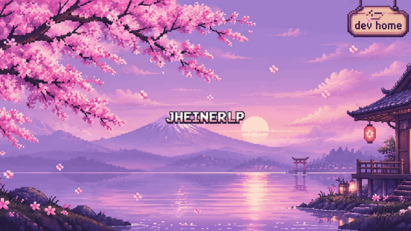
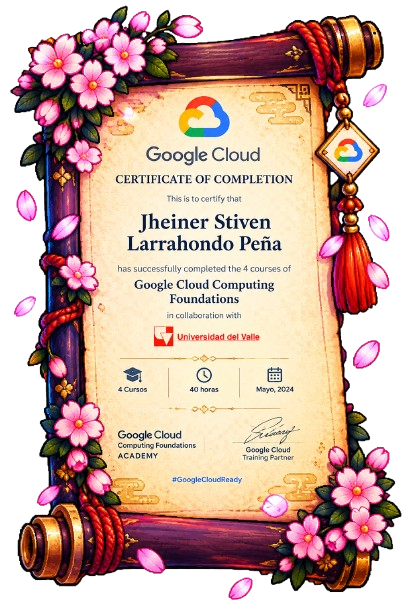
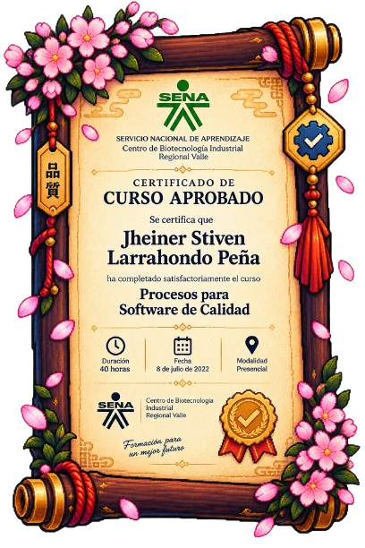

<!-- ======================================================= -->
<!-- SECCIÓN 1: BANNER PRINCIPAL                             -->
<!-- ======================================================= -->

  

 

<!-- ======================================================= -->
<!-- SECCIÓN 2: PRESENTACIÓN PERSONAL                        -->
<!-- ======================================================= -->

  
  
<strong>Jheiner</strong> | <code>@JHEINERLP</code>

  

    Desarrollador de software enfocado en la construcción de aplicaciones web robustas,
    gestión eficiente de bases de datos y despliegue con contenedores.
    Apasionado por el aprendizaje continuo, las buenas prácticas y la disciplina del dojo digital.
  

  

    ☕ <em>Construyendo soluciones eficientes paso a paso, línea a línea.</em>
  

 

<!-- ======================================================= -->
<!-- SECCIÓN 3: BOTONES DE CONTACTO Y REDES SOCIALES         -->
<!-- ======================================================= -->

  <!-- 1. Follow GitHub (Rojo con texto blanco) -->
  
  &nbsp;
  <!-- 2. LinkedIn (Identidad visual oficial) -->
  
  &nbsp;
  <!-- 3. Portafolio Web (Paleta Dev Home) -->
  

 

  

<!-- ======================================================= -->
<!-- SECCIÓN 4: TECNOLOGÍAS Y HERRAMIENTAS                   -->
<!-- ======================================================= -->

  
  
<em>Habilidades y tecnologías forjadas en el dojo de desarrollo</em>

<!-- Fila 1: Lenguajes y Frontend -->

  
  &nbsp;
  
  &nbsp;
  
  &nbsp;
  

<!-- Fila 2: Frameworks, Contenedores y Control de Versiones -->

  
  &nbsp;
  
  &nbsp;
  
  &nbsp;
  

<!-- Fila 3: Bases de Datos y Cloud -->

  
  &nbsp;
  
  &nbsp;
  
  &nbsp;
  

 

  

<!-- ======================================================= -->
<!-- SECCIÓN 5: ESTADÍSTICAS DE GITHUB                       -->
<!-- ======================================================= -->

  

 

  

  
  &nbsp;
  

  

 

<!-- ======================================================= -->
<!-- SECCIÓN 6: JARDÍN SAKURA — FLORACIÓN DE CONTRIBUCIONES  -->
<!-- ======================================================= -->

  
  
<em>Cada commit florece en el dojo: disciplina, constancia y crecimiento paso a paso</em>

  

 

  

<!-- ======================================================= -->
<!-- SECCIÓN 7: CERTIFICADOS, FORMACIÓN Y LOGROS             -->
<!-- ======================================================= -->

  
  
<em>Credenciales, estudios y reconocimientos alcanzados en el camino</em>

### 🏅 Medallas — Certificaciones Verificables 🏅 

  

  <strong>Introduction to Python</strong> — <a href="https://www.sololearn.com/certificates/CC-JTKREN6P">SoloLearn</a> (Credencial verificable: <code>CC-JTKREN6P</code>)

 

### 📜 Pergaminos — Formación Académica e Investigación 📜

  
  &nbsp;&nbsp;
  
  &nbsp;&nbsp;
  

| Formación / Proyecto | Institución | Detalle y Modalidad |
| :--- | :--- | :--- |
| **Semillero de Investigación IDiCA (Sidpt)** | Universidad del Valle | Vicerrectoría de Investigaciones · Periodo 2025-II |
| **Google Cloud Computing Foundations** | Universidad del Valle & Google Cloud | 4 cursos completados · 40 horas · Mayo 2024 |
| **Procesos para Software de Calidad** | SENA — Centro de Biotecnología Industrial | Formación presencial · 40 horas · Julio 2022 |

 

### 🎋 Tablillas — Cursos y Formaciones Específicas 🎋

  
  &nbsp;&nbsp;&nbsp;&nbsp;
  

| Curso Especializado | Plataforma / Emisor | Certificación |
| :--- | :--- | :--- |
| **Curso de Laravel Profesional** | Código Facilito | 2 h 6 min · Completado en Julio 2025 |
| **Aspectos básicos: Datos, datos, en todas partes** | Coursera · Google Career Certificates | Certificado de Finalización · Marzo 2025 |

 

  

<!-- ======================================================= -->
<!-- SECCIÓN 9: CIERRE DEL PERFIL                            -->
<!-- ======================================================= -->

一歩ずつ — Un paso a la vez.

Cada línea de código es una oportunidad para aprender.

🏮 Sigue practicando. Sigue construyendo. Sigue creciendo.

 

🌸 Dev Home — GitHub Dojo · <a href="https://github.com/JHEINERLP">JHEINERLP</a> 🌸

